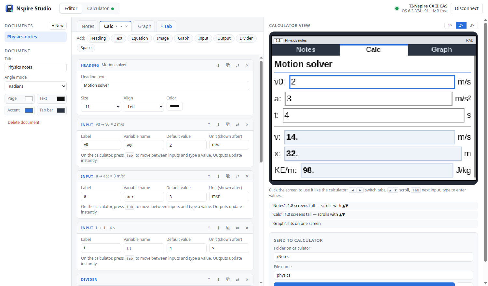
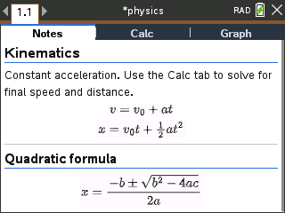

<p align="center"></p>

<h1 align="center">Nspire Studio</h1>

<p align="center">Make notes for your <b>TI-Nspire CX / CX II</b> on your computer: tabs, text,
typeset equations, images, graphs and live calculators. Then send them to the calculator over USB.</p>

<p align="center"><a href="../../releases/latest"><b>Download</b></a> ·
<a href="#install">Install</a> · <a href="#using-it">Using it</a> · <a href="#building-from-source">Build</a></p>



## Features

- **Tabs** across the top of the calculator screen. Switch between them with ◀ ▶ on the calculator.
- **Text and headings** in the calculator's own fonts, with size, bold/italic, colour and alignment.
- **Equations** written in LaTeX (fractions, roots, sums, integrals, matrices, Greek letters…),
  rendered so they look properly typeset on the calculator. A button bar inserts the common pieces.
- **Images**: drop, paste or pick a file; it is scaled to fit the 318 × 212 screen.
- **Graphs** of `y = f(x)` with your own window and grid. Functions can use your input variables.
- **Inputs and outputs**: labelled variables you type into on the calculator, and outputs
  (formulas like `m*acc`) that recompute instantly using the calculator's own math engine.
  Name an output to use it in later outputs and graphs. On CAS models `solve()` and exact answers work too.
- **Live calculator view**: a pixel-accurate replica of the calculator screen that updates as you
  edit. Click it to switch tabs, scroll, and type into inputs exactly like on the calculator.
  It warns you when a tab name is cut off or an equation had to be shrunk.
- **Calculator panel**: connect / disconnect, see the model, OS, battery and free space, browse the
  calculator's files (download, upload, rename, delete, new folder) and take screenshots.
- Documents are saved automatically on your computer, and you can **save them to / open them from
  `.nsnotes` files** (one self-contained file with images included) to back up, move or share them.

<p align="center"></p>

## Install

Get the files from the [latest release](../../releases/latest).

| System | File | How |
|---|---|---|
| **Fedora** 44+ | `nspire-studio-<version>.x86_64.rpm` | `sudo dnf install ./nspire-studio-*.rpm` |
| **Debian** 13+, **Ubuntu** 25.04+ | `nspire-studio_<version>_amd64.deb` | `sudo apt install ./nspire-studio_*.deb` |
| **Windows** 10/11 (64-bit) | `NspireStudio-<version>-Setup.exe` | Run it (no admin rights needed) |
| Windows, no install | `NspireStudio-<version>-Windows-portable.zip` | Unzip, run `NspireStudio.exe` |

Then open **Nspire Studio** from your application menu / Start menu.

On Linux the package also installs a udev rule, so the calculator works without root. If you
installed it with the calculator already plugged in, unplug and replug it once.

### Windows USB driver

Nspire Studio talks to the calculator through [libusb](https://libusb.info), which on Windows needs
the **WinUSB** driver on the calculator:

1. Plug in the calculator and turn it on.
2. Download and run [Zadig](https://zadig.akeo.ie).
3. Choose *Options → List All Devices*, pick **TI-Nspire** (it may show as *TI-Nspire CX II*), select
   **WinUSB** and click *Replace Driver* (or *Install Driver*).

> **Note:** while WinUSB is installed, TI's own *TI-Nspire CX Student Software / TI Connect* can't see the
> calculator. To go back, open *Device Manager*, find the calculator, choose *Uninstall device* (tick
> *delete the driver*) and replug it. You can always use **.tns** (next to *Send*) to save the file
> and copy it with TI's software instead.

## Using it

1. Click **Connect** (top right). Next time it reconnects by itself whenever the calculator is plugged in.
2. Build your document: add tabs with **+ Tab** (double-click a tab to rename it), then use the
   **Add** bar for headings, text, equations, images, graphs, inputs and outputs.
3. Watch the **Calculator view** on the right; click it and use the arrow keys, `Tab` and numbers to try it.
4. Choose a folder and file name and press **Send to calculator**.
5. On the calculator: *Home → Browse*, open the folder and the file.

**On the calculator:** ◀ ▶ switch tabs · ▲ ▼ scroll · `tab` next input · type a value · `del` erases ·
`clear` empties the field. Outputs and graphs update as you type.

### Inputs, outputs and formulas

Give each input a **variable name** (letters, digits and `_`, e.g. `m`, `v0`, `theta`). Outputs are
formulas in calculator syntax that use those names:

| You want | Write |
|---|---|
| multiply, divide, power | `m*acc`, `d/t`, `x^2` |
| roots, logs | `sqrt(x)`, `root(x,3)`, `ln(x)`, `log(x)` (base 10), `log(x,2)` |
| trig (document angle mode) | `sin(theta)`, `arctan(y/x)` |
| π | `pi` or `π` |
| CAS only | `solve(F=m*a,a)`, exact results (tick *Exact result*) |

Set *Decimal places* to round the answer, and *Save result as* to reuse it, e.g. an output
`vf = v0+acc*tt` lets a later output use `vf^2/2` and a graph plot `vf*x`.

### Files

**Save to file…** (Ctrl+Shift+S) writes the open document to a `.nsnotes` file; **Open file…** (Ctrl+O)
loads one. You can also drag a `.nsnotes` file onto the window, or double-click it in your file
manager / Explorer. If the document is already in your list you can replace it or open it as a copy.

### Where things are kept

- Documents: `~/.local/share/nspire-studio/projects` (Linux), `%APPDATA%\NspireStudio\projects` (Windows).
- On the calculator, the default folder is `/Notes` (shown as *Notes* in *My Documents*).

## How it works

Each document becomes a `.tns` file containing a small Lua program (`runtime.lua`) plus your content.
Equations and images are rendered on the computer (MathJax / canvas), converted to the calculator's
16-bit image format and compressed. Inputs, outputs and graphs are evaluated on the calculator with
`math.evalStr`, so they use the real TI math engine. The `.tns` is packed with
[Luna](https://github.com/ndless-nspire/Luna) and sent with
[libnspire](https://github.com/Vogtinator/libnspire).

```
app.py        desktop window (Qt WebEngine)       server.py   local API used by the window
calc.py       USB: libnspire via ctypes           builder.py  document → Lua → .tns
runtime.lua   the viewer that runs on the calc    static/     the editor UI
packaging/    .deb, .rpm and Windows installer    scripts/    native build + CI smoke test
```

## Building from source

Linux (Fedora names shown; Debian: `libusb-1.0-0-dev zlib1g-dev python3-pyside6.* python3-pil`):

```bash
git clone --recursive https://github.com/ezeren76neptune/nspire-studio.git
cd nspire-studio
sudo dnf install gcc gcc-c++ make autoconf automake libtool libusb1-devel zlib-ng-compat-devel \
                 python3-pyside6 python3-pillow
./scripts/build-native.sh      # builds libnspire and Luna into ./native
./start.sh                     # run the app (./start.sh --browser to use a web browser instead)
```

Packages: `packaging/linux/build-rpm.sh`, `packaging/linux/build-deb.sh`. The Windows build
(MSYS2 + PyInstaller + Inno Setup) is in [`.github/workflows/release.yml`](.github/workflows/release.yml);
pushing a `v*` tag builds every package and publishes a release.

## Compatibility

Tested with a TI-Nspire CX II CAS on OS 6.3. The CX / CX CAS (OS 4.x+) should also work; older
monochrome models are not supported.

## Credits and licence

Nspire Studio is licensed under the **GNU GPL v3.0 or later** (see [LICENSE](LICENSE)).

It builds on [libnspire](https://github.com/Vogtinator/libnspire) (GPL-3.0),
[Luna](https://github.com/ndless-nspire/Luna) (MPL-1.1), [MathJax](https://www.mathjax.org) and
[math.js](https://mathjs.org) (Apache-2.0), and [Qt for Python](https://www.qt.io/qt-for-python) (LGPL-3.0).
TI-Nspire is a trademark of Texas Instruments, which is not affiliated with this project.
